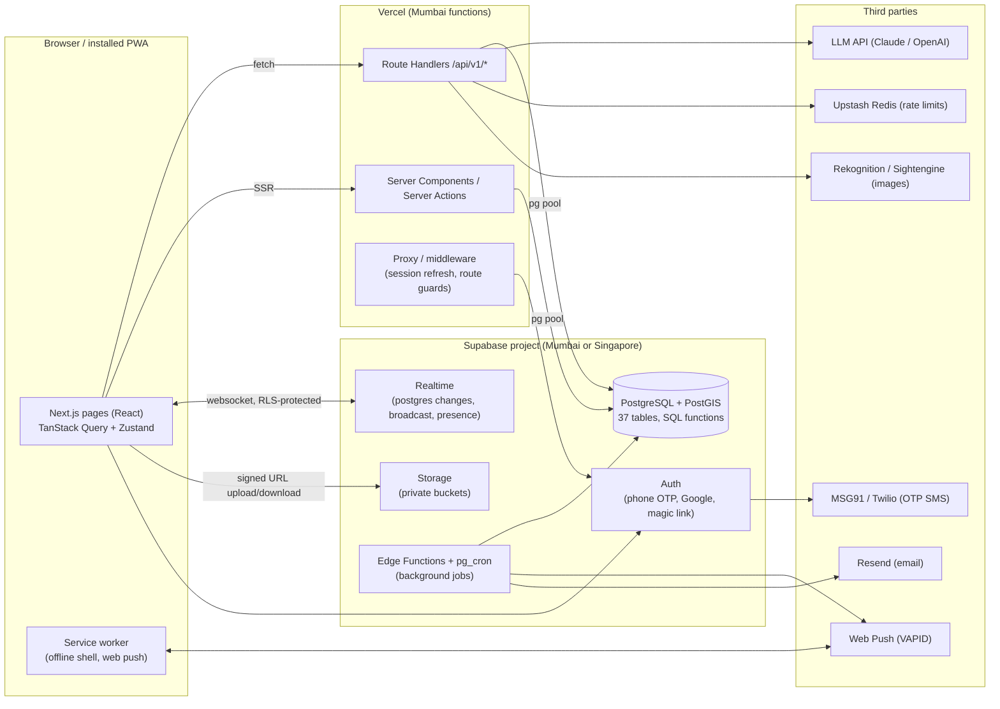
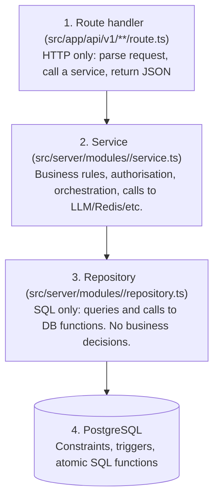
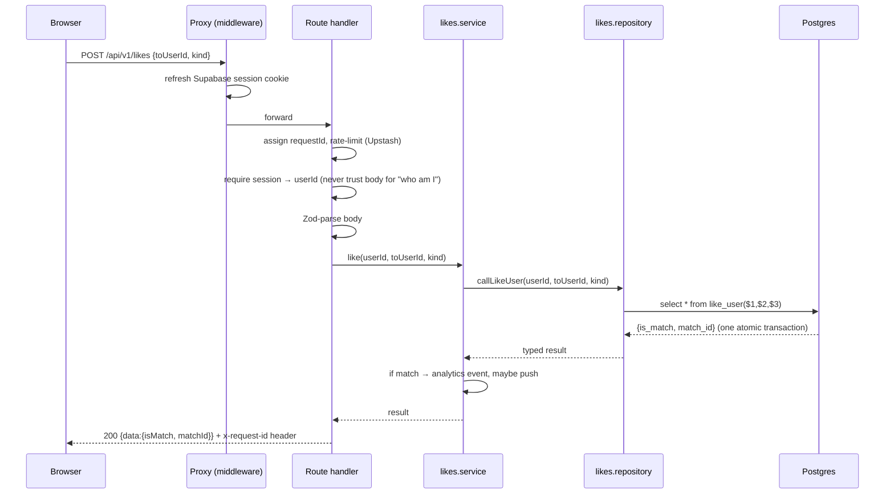

# 02 – Architecture

## System overview

**How to read it:** the browser talks to *our* Next.js server for everything that needs a business rule
(like, match, review, send message). It talks *directly* to Supabase only for three things that are
safe to expose because Supabase enforces access control itself: signing in, receiving realtime events,
and uploading/downloading files through short-lived signed URLs.

## The layering rule (most important page in this doc)

Every backend request passes through the same four layers. Each layer may only call the one below it.

| Layer | May do | Must never do |
|-------|--------|---------------|
| Route handler | Validate input with Zod, read the session, call exactly one service function, shape the response | Contain SQL, contain business `if`s |
| Service | Decide *who may do what*, combine repositories, call external APIs, emit analytics | Know about `Request`/`Response`, write raw SQL |
| Repository | Parameterised SQL, map rows → typed objects | Check permissions, call external APIs |
| Database | Enforce invariants (unique pairs, age ≥ 18, one open review per match), run multi-step operations atomically (`like_user`, `claim_next_review`) | – |

**Why so strict?** Because when the app has 40 endpoints, "where is the rule that stops a blocked user
from liking someone?" must have exactly one answer. (Answer: inside `like_user()` in the database, and the
service just calls it.)

## Where each kind of logic lives

| Kind of rule | Lives in | Example |
|--------------|----------|---------|
| *Data can never be invalid* | Postgres constraints / triggers | `matches_pair_order`, `enforce_min_age`, `reviews_one_open_per_match` |
| *Multi-step change must be all-or-nothing* | Postgres functions (called from repositories) | `like_user()`, `submit_review_outcome()`, `purge_deleted_accounts()` |
| *Who is allowed?* | Service layer (and RLS as a second wall for direct-to-Supabase access) | "only the assigned astrologer may submit this review" |
| *Is the input well-formed?* | Zod schemas in `src/shared/schemas` (same file used by the form *and* the API) | `likeInputSchema` |
| *Call something outside our system* | Service layer, behind a small interface in `src/server/integrations/` | `sendOtp`, `moderateImage`, `generatePrompt` |
| *Runs on a timer* | Supabase `pg_cron` + Edge Function, or a protected cron route | deadline reminders, Iceberg prompt timing, purge |

## Request lifecycle (what happens on `POST /api/v1/likes`)

On any error, the route wrapper turns the thrown `AppError` into the standard error body (doc 05) and logs
it with the same `requestId`, so a bug report with that id leads straight to the log line.

## Real-time design

- **Messages** are written by the API (`POST …/messages`) so rules (blocked? conversation closed? moderation?) run server-side. Browsers *subscribe* to `INSERT` on `messages` via Supabase Realtime. RLS lets a user subscribe only to rows in conversations they participate in.
- **Typing indicators and online presence** use Realtime *broadcast* / *presence* and are never stored.
- **Read receipts** update `conversation_participants.last_read_message_id` (one cheap write per "open chat", not one per message).
- **Fallback:** if the socket drops, TanStack Query refetches the latest page on reconnect; the message list is always "fetch + live patches", never "socket only".

## Scalability approach

| Concern | MVP approach | When it gets busy |
|---------|--------------|-------------------|
| API compute | Stateless Vercel functions scale horizontally for free | Keep functions short; move slow work to background jobs |
| DB connections | Use Supabase **pooler** (port 6543, transaction mode) from serverless; small `max` per instance | Add read replica for Discover; PgBouncer already in place |
| Discover query | GiST index on `profiles.location`, GIN on intent arrays, `limit/offset` | Precompute candidate sets per user; switch to keyset pagination |
| Hot lists (chat list, notifications) | Indexes already exist (`idx_messages_conv_time`, `idx_notifications_user`) | Partition `messages` by month |
| Expensive calls (LLM, OTP) | Per-user + per-IP rate limits in Redis; levels 1–2 prompts need no LLM | Queue + budget guard per day |
| Images | Client-side resize before upload, Supabase transforms for thumbnails | CDN in front (Cloudflare) |
| Idempotency | Client-generated ids for messages and moves; `on conflict` in SQL | – |

## Decision log

| # | Decision | Alternatives considered | Why |
|---|----------|------------------------|-----|
| D1 | **One Next.js app (`web/`) serves UI and API** | Separate Express/Fastify service | One deploy, one language, shared Zod schemas, free horizontal scaling on Vercel. We keep strict layering so the `server/` folder can be lifted into its own service later without rewriting. |
| D2 | **Backend talks to Postgres with plain SQL (`pg`) through repositories**, not through `supabase-js` queries | supabase-js `.from().select()`, Prisma, Drizzle | Our important rules are SQL functions (`like_user(...)`). Calling them with SQL is the most direct, fastest, and most testable path. `supabase-js` is still used for Auth, Storage and Realtime. Kysely/Drizzle can be added later behind the same repositories. |
| D3 | **Supabase Auth owns identity; `users.id` = `auth.users.id`** | Our own OTP/session tables (`auth_otps`, `user_sessions` exist in the schema) | A dating app must not hand-roll OTP, refresh tokens and session revocation. The two spare tables are dropped in a later migration once Auth is wired (M1). |
| D4 | **Authorisation is enforced in services; RLS is the second wall** | RLS only | Our logic needs the service layer anyway (LLM, Redis, rate limits). RLS covers direct-to-Supabase paths (Realtime, Storage) and protects us if a route is ever written wrongly. |
| D5 | **Migrations stay as numbered SQL files in `db/`**, applied by `db/scripts/migrate.js` to every environment | Supabase CLI migrations, Prisma Migrate | Already built and tested. Works against local Docker, staging and production with only `DATABASE_URL` changing. |
| D6 | **Three environments, two long-lived branches** (`staging`, `main`) | Trunk with feature flags only | Gives a clear promote step: the same commit that passed QA on staging is fast-forwarded to `main`. Detail in doc 04. |
| D7 | **Mobile-first responsive PWA** | Separate desktop site | One codebase; the design board is mobile, desktop gets an adapted layout (doc 06). |
| D8 | **Zod schemas shared between client forms and server routes** (`src/shared`) | Duplicate validation | A single definition of "valid" cannot drift. |
