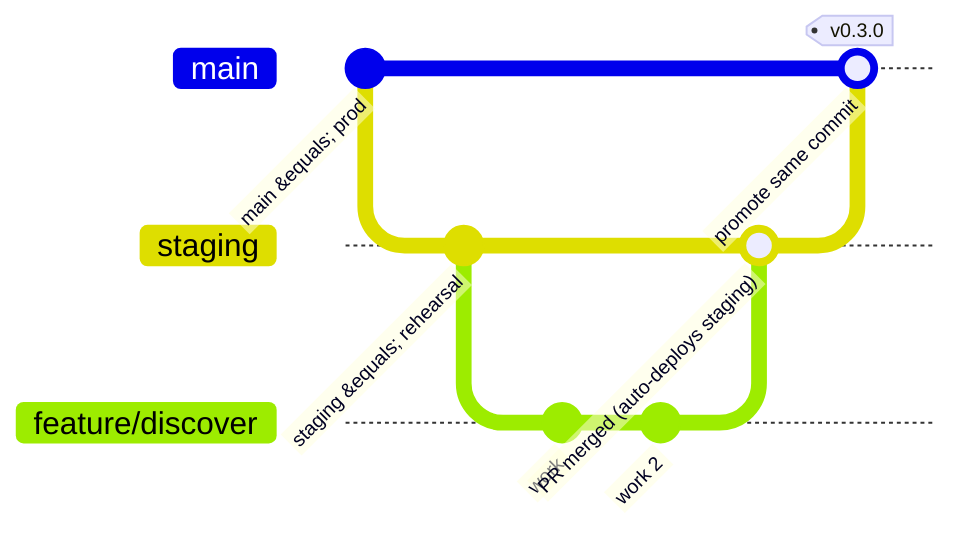
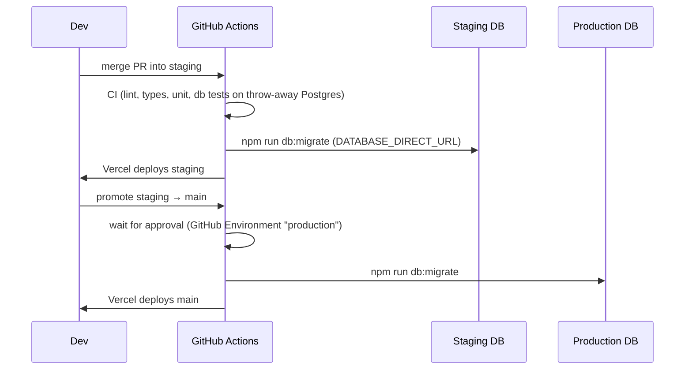

# 04 – Environments and deployment

Goal: **test on staging, then ship the exact same code to production.** Only configuration differs.

## The three environments

| | Local | Staging | Production |
|--|-------|---------|------------|
| Purpose | Day-to-day coding, unit/DB tests | Realistic rehearsal: QA, demo, end-to-end tests | Real users |
| Git branch | any feature branch | `staging` | `main` |
| App hosting | `npm run dev` on your laptop | Vercel (branch `staging`, domain `staging.<yourdomain>`) | Vercel (Production Branch = `main`, `<yourdomain>`) |
| Postgres / Auth / Storage | Docker Postgres+PostGIS (`db/docker-compose.yml`), plus Supabase local stack when working on auth/realtime/storage | **Separate** Supabase project | **Separate** Supabase project |
| Data | Fake dev seed (`db/seed/dev_data.sql`) | Fake dev seed + test accounts, never real people | Reference data only (colleges, interests, prompts) |
| OTP SMS | Supabase test OTP (`123456`), nothing sent | Test numbers + a few real ones for the team | Real provider (MSG91) |
| LLM / moderation | Fake implementations | Real APIs with low spend cap | Real APIs |
| Analytics / errors | Off | PostHog + Sentry (`environment=staging`) | PostHog + Sentry (`environment=production`) |
| `APP_ENV` | `local` | `staging` | `production` |

> **"Testing environment"** = two things in this setup: *automated tests* run in CI on every PR
> (against a throw-away Postgres container), and *staging* is where humans and Playwright test the
> deployed build. We do not need a fourth long-lived environment.

## One codebase, different config

The code reads everything from environment variables validated in `web/src/env.ts`.
There is **no** `if (production)` branching in business code. The only allowed branches are inside
`src/server/integrations/*` (choose real vs fake client based on config) and in logging verbosity.

| Variable | Scope | Notes |
|----------|-------|-------|
| `APP_ENV` | server | `local` / `staging` / `production` |
| `NEXT_PUBLIC_APP_URL` | public | Used for redirects, QR deep links |
| `NEXT_PUBLIC_SUPABASE_URL`, `NEXT_PUBLIC_SUPABASE_ANON_KEY` | public | Safe to expose (RLS protects data) |
| `SUPABASE_SERVICE_ROLE_KEY` | **server only** | Bypasses RLS. Used only in admin/system code paths. |
| `DATABASE_URL` | **server only** | Pooler URL for the app (port 6543) |
| `DATABASE_DIRECT_URL` | CI only | Direct URL (port 5432) used for migrations |
| `UPSTASH_REDIS_REST_URL/TOKEN` | server | Rate limiting |
| `LLM_API_KEY`, `LLM_DAILY_BUDGET_USD` | server | Iceberg AI |
| `RESEND_API_KEY`, `VAPID_*`, `SENTRY_DSN`, `POSTHOG_KEY` | mixed | See `web/.env.example` |

Where values live:

| Environment | Where the secrets are stored |
|-------------|------------------------------|
| Local | `web/.env.local` and `db/.env` (git-ignored) |
| Staging | Vercel → Project → Environment Variables → *Preview* scoped to branch `staging`; GitHub → Environment `staging` for DB migration secrets |
| Production | Vercel → *Production*; GitHub → Environment `production` (with required reviewers) |

## Branching and promotion

**Daily flow**

1. Branch from `staging`: `git switch -c feature/discover staging`.
2. Open a PR **into `staging`**. CI runs; Vercel posts a **preview URL** (which uses the *staging* Supabase project so reviewers see realistic data).
3. Merge the PR → Vercel deploys `staging`; GitHub Action applies new migrations to the **staging DB first**.
4. QA on staging (manual checklist + Playwright smoke test).
5. **Promote:** open a PR `staging → main` (or `git push origin staging:main` when it is a fast-forward). The commit SHA is identical to what you tested.
6. The `production` GitHub Environment requires an approval click, then the Action applies migrations to the **production DB**, and Vercel deploys `main`.
7. Tag the release (`v0.3.0`). Sentry release = git SHA.

**Hotfix:** branch from `main`, PR into `main`, then merge `main` back into `staging` so branches do not diverge.

## Database migrations in the pipeline

Migration rules (these protect production data):

1. **Forward-only.** New change = new file `011_*.sql`. Never edit an applied file.
2. **Backwards-compatible first.** The *old* code must keep working while the migration runs, because migrations run before the new deploy. Pattern: add column → deploy code that writes both → backfill → (later migration) drop old column. Never rename/drop in the same release as the code change.
3. **Each file runs in one transaction** (the runner already does this). Avoid `create index concurrently` in the normal path; if a big table needs it, put it in its own migration marked `-- no-transaction` and extend the runner.
4. **Test it on staging first** – by construction, because staging is always migrated before production.
5. **Reset is local-only** – `db:reset` refuses non-localhost URLs. Keep it that way.
6. **Seed rules:** `reference_data.sql` is safe everywhere; `dev_data.sql` is skipped when `NODE_ENV=production` (already implemented in `db/scripts/lib.js`). **For staging**, `NODE_ENV` is `production` in Vercel, so staging gets reference data only; to load the fake people on staging run the seed with `SEED_DEV_DATA=true` (small change planned in M1).

## CI (runs on every PR and push)

`.github/workflows/ci.yml`:

| Job | Steps | Fails the PR when |
|-----|-------|-------------------|
| `web` | `npm ci` → `lint` → `typecheck` → `vitest` → `next build` | any step fails |
| `db` | start `postgis/postgis` service → `npm ci` → `db:migrate` → `db:seed` → `db:test` | migration or SQL test fails |

`.github/workflows/migrate.yml` (runs on push to `staging` and `main`): applies migrations to the matching
Supabase project using the Environment's secrets.

Branch protection (set in GitHub → Settings → Branches): require the two CI jobs to pass and require a PR for
`staging` and `main`.

## Vercel configuration checklist

1. Import the GitHub repo, set **Root Directory = `web`**.
2. Production Branch = `main`.
3. Functions region = **Mumbai (`bom1`)** (set in `vercel.json`).
4. Add the `staging` domain and assign it to the `staging` branch.
5. Environment variables: add the *Production* set (for `main`) and the *Preview* set restricted to branch `staging`. Other preview branches inherit the staging values.
6. Turn on **Deployment Protection** for non-production URLs so staging is not publicly browsable (or protect with a shared password).

## Supabase configuration checklist (per project)

1. Create `iceberg-staging` and `iceberg-prod` (region: Mumbai if available, else Singapore).
2. Extensions are created by migration `001` (`postgis`, `citext`, `pgcrypto`).
3. Auth → Providers: enable Phone (with SMS provider), Google, Email (magic link). Add the correct **redirect URLs** for each environment.
4. Storage: create private buckets `photos`, `voice-intros`, `chat-media` (policies are in a later migration).
5. Production only: enable **Point-in-Time Recovery**, and schedule the weekly export to our own storage.
6. Copy the pooler URL → `DATABASE_URL`, direct URL → `DATABASE_DIRECT_URL` into Vercel / GitHub secrets.

## Rollback plan

| Problem | Action |
|---------|--------|
| Bad frontend/API deploy | Vercel → Deployments → *Promote* the previous deployment (instant, no rebuild). |
| Bad migration | Migrations are forward-only: write migration `0NN_fix.sql` and ship via the normal pipeline. For data loss, restore from PITR into a new project and swap. |
| Leaked secret | Rotate in the provider, update Vercel/GitHub, redeploy. Review `audit_log` for the window. |

## Release checklist (copy into each promotion PR)

- [ ] CI green on `staging`
- [ ] Migration applied on staging; app works with it
- [ ] Manual smoke: sign in → discover → like → match → chat → settings
- [ ] Playwright smoke passed against staging
- [ ] No new env var missing in production (compare `web/.env.example` with Vercel)
- [ ] Sentry shows no new error groups on staging for 24 h
- [ ] Approver clicked *Approve* on the `production` environment
