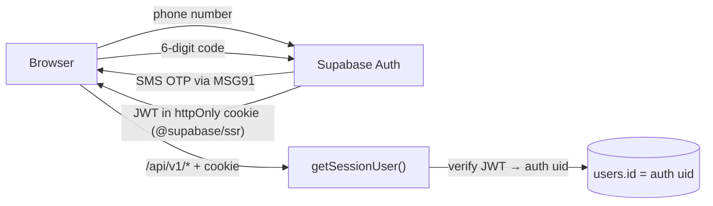

# 05 – Backend guide

The backend is the `web/src/server/` folder plus the route files under `web/src/app/api/`.
Read doc 02 first for the four layers. This doc is the practical manual.

## Folder layout

```
web/src/
├── app/api/
│   ├── health/route.ts              liveness  (no dependencies)
│   ├── ready/route.ts               readiness (checks the DB)
│   └── v1/<resource>/route.ts       the public API; one folder per URL segment
├── env.server.ts / env.public.ts    validated configuration
├── instrumentation.ts               fail-fast on boot (+ Sentry later)
├── shared/schemas/                  Zod schemas used by BOTH browser and server (no server-only imports)
└── server/                          server-only code (every file starts with `import "server-only"`)
    ├── db/pool.ts                   pg pool, query(), withTransaction()
    ├── http/
    │   ├── route.ts                 apiRoute() wrapper, ok()
    │   └── errors.ts                AppError family + Postgres error mapping
    ├── auth/session.ts              getSessionUser()  (Supabase in M1)
    ├── logger.ts                    pino
    ├── integrations/                one folder per third party, each with a real + fake client
    │   ├── otp/ llm/ moderation/ push/ email/ ratelimit/ analytics/
    └── modules/                     one folder per feature
        └── <feature>/
            ├── repository.ts        SQL only
            ├── service.ts           business rules; the ONLY thing routes call
            └── <feature>.test.ts    unit tests (+ *.int.test.ts for real-SQL tests)
```

`modules/reference/` (interests, colleges) is the finished example. Copy its shape.

## API conventions

| Topic | Rule |
|-------|------|
| Base path | `/api/v1/...`. Breaking changes ship as `/api/v2` so old clients keep working. |
| Naming | Plural nouns, kebab-case: `/matches/:id/unmatch`. Actions that are not CRUD are `POST /<noun>/:id/<verb>`. |
| Success body | `{ "data": ..., "meta"?: {...} }` |
| Error body | `{ "error": { "code", "message", "requestId", "details"? } }` – `code` is stable and machine-readable (`validation_failed`, `unauthorized`, `forbidden`, `not_found`, `already_exists`, `rule_violation`, `rate_limited`, `internal_error`). |
| Status codes | 200 ok · 201 created · 204 no body · 400 validation · 401 not signed in · 403 not allowed · 404 not found (also used for "exists but you may not know about it") · 409 conflict · 422 business rule · 429 rate limit · 500 our bug |
| Identity | **Always** from the session. No endpoint takes `userId` for "me". Endpoints about *other* people take `:id` and the service checks the relationship. |
| Pagination | Cursor-based: `?limit=20&cursor=<opaque>` → `meta: { nextCursor }`. `limit` max 50. Never return unbounded lists. |
| Timestamps | ISO-8601 UTC strings. |
| IDs | UUIDs. Client-created things (messages, game moves) accept a client-generated UUID so retries are idempotent. |
| Caching | Authenticated responses: `cache-control: private, no-store`. Public reference data: `public, s-maxage=3600`. |
| Rate limits | Declared per route (`rateLimit: { key: "like", limit: 100, window: "1 h" }`) once Upstash is added in M1. |

## How to add an endpoint (the recipe)

Example: `POST /api/v1/likes`.

1. **Schema** – `src/shared/schemas/likes.ts`
   ```ts
   export const likeInputSchema = z.object({ toUserId: z.uuid(), kind: z.enum(["like", "super_like"]).default("like") });
   ```
2. **Repository** – `modules/likes/repository.ts` (SQL only)
   ```ts
   export async function likeUser(from: string, to: string, kind: LikeKind) {
     const { rows } = await query<{ is_match: boolean; out_match_id: string | null }>(
       "select * from like_user($1, $2, $3)", [from, to, kind]);
     return rows[0];
   }
   ```
3. **Service** – `modules/likes/service.ts` (rules, orchestration)
   ```ts
   export async function like(userId: string, input: LikeInput) {
     const r = await repo.likeUser(userId, input.toUserId, input.kind);
     if (r.is_match) analytics.capture(userId, "match_created", { matchId: r.out_match_id });
     return { isMatch: r.is_match, matchId: r.out_match_id };
   }
   ```
4. **Route** – `app/api/v1/likes/route.ts` (HTTP only)
   ```ts
   export const POST = apiRoute({ auth: "user" }, async (ctx) => {
     const input = await ctx.body(likeInputSchema);
     return ok(await like(ctx.user!.id, input), { status: 201 });
   });
   ```
5. **Tests** – unit test the service with a fake repository; integration test the repository against the real DB; (E2E later).
6. **Docs** – add the row to the endpoint table below if it is new.
7. **Client** – add a typed function + TanStack Query hook in `src/features/<feature>/api.ts` (doc 06).

## Database access rules

1. **Parameterised queries only.** `query("... where id = $1", [id])`. Never build SQL with template strings from user input.
2. **Call the SQL functions for multi-step rules**: `like_user`, `pass_user`, `claim_next_review`, `submit_review_outcome`, `resubmit_for_review`, `unmatch`, `block_user`, `request_account_deletion`, `discover_profiles`.
3. **A single statement is already atomic.** Use `withTransaction` only when you must combine several statements that are *not* in one SQL function.
4. **No session state.** The pooler is in transaction mode: no `SET`, no `LISTEN`, no advisory *session* locks, no named prepared statements.
5. **Select only the columns you need.** Never `select *` into an API response (new columns would leak automatically).
6. **Map to camelCase at the repository boundary** so snake_case never leaves the server.
7. **Photos and voice**: store only the storage *path*; produce a signed URL (short TTL) in the service when returning data.

## Error handling

- Services throw `AppError` subclasses (`NotFoundError`, `ForbiddenError`, `ConflictError`, `DomainError`…).
- Errors raised by our SQL functions (`raise exception 'Profile not available'`) arrive as Postgres code `P0001` and are shown to the user as a 422 with that exact message – **so write those messages for users**.
- Unique/foreign-key/check violations are mapped to 409/404/400 automatically.
- Everything else is a 500 with a generic message; details go to logs and Sentry with the `requestId`.

## Authentication and authorisation (Milestone 1)



- **First sign-in** creates `auth.users` (Supabase). `POST /api/v1/me/bootstrap` then inserts the app's `users` row with the same id, the date of birth (18+ check), and consent rows. Until that call succeeds the user is routed to onboarding.
- `getSessionUser()` verifies the cookie, loads `{ id, role, status }`, and rejects `suspended`/`banned`/`deactivated` accounts with 403.
- **Role checks** are declarative: `apiRoute({ auth: ["astrologer"] }, ...)`.
- **Ownership checks** live in services: "is this user a participant of this conversation?" is a repository query (`isParticipant`) called before any read/write.
- **Astrologers never read base tables.** They use `astrologer_review_view` (exposes birth data and names only – no photos, phone, email or messages).

## Compatibility score (MVP, v0 – deliberately simple and explainable)

Stored in `compatibility_scores` (before a match) and copied to `matches.score_breakdown`.
Keys come from the design: `emotional`, `communication`, `values`, `long_term`; `score` = rounded weighted mean.

| Part | Weight | v0 inputs |
|------|--------|-----------|
| emotional | 30% | Moon-sign element compatibility (fire/air, earth/water) if both consented, else interests in the "Pets/Food/Movies" categories overlap |
| communication | 25% | Sun-sign element + shared interest count |
| values | 25% | Same `intent` values, same prompt answers on selected questions |
| long_term | 20% | Intent alignment + age-range overlap |

Rules: computed on the server only, cached for 7 days, recomputed when either profile changes, **never presented as a prediction** – the UI says "compatibility insights". The astrologer's decision, not this number, gates chat. When we want real ephemeris calculations we replace the function behind `computeCompatibility()`; nothing else changes.

## Background jobs

| Job | Trigger | What it does | Where |
|-----|---------|--------------|-------|
| Review reminders | every 15 min | notify astrologers with reviews due < 4 h; escalate overdue ones | pg_cron → Edge Function |
| Iceberg prompt scheduler | every 5 min | for conversations with `next_prompt_at <= now()`, send the next prompt (levels 1–2 from the library, 3–4 via LLM) | pg_cron → Edge Function |
| Waitlist promotion | on cancellation + hourly | move first `waitlisted` registrations to `registered`; notify | SQL function + cron |
| Event reminders | hourly | `event_reminder` notifications 24 h and 2 h before | pg_cron |
| Account purge | daily 03:00 IST | `select purge_deleted_accounts()` | pg_cron |
| Stale OTP / session cleanup | daily | delete expired rows | pg_cron |

All jobs are **idempotent** (safe to run twice) and write one `audit_log` row for sensitive effects.

## Endpoint catalogue

Auth column: **P** public · **U** signed-in user · **A** astrologer · **M** moderator · **Ad** admin.
Milestone column says when it is built.

### Platform
| Method | Path | Auth | Purpose | M |
|--------|------|------|---------|---|
| GET | `/api/health` | P | liveness | M0 ✅ |
| GET | `/api/ready` | P | readiness (DB) | M0 ✅ |
| GET | `/api/v1/interests` | P | list interests | M0 ✅ |
| GET | `/api/v1/colleges` | P | list active colleges | M0 ✅ |

### Account and profile
| Method | Path | Auth | Purpose | M |
|--------|------|------|---------|---|
| POST | `/api/v1/me/bootstrap` | U (auth only, no app row yet) | create `users` row, DOB, consents | M1 |
| GET | `/api/v1/me` | U | account + profile + settings + completeness | M1 |
| PATCH | `/api/v1/me/profile` | U | name, bio, occupation, city, intent, preferences | M2 |
| PUT | `/api/v1/me/interests` | U | replace interests (max 10) | M2 |
| POST | `/api/v1/me/photos` | U | request signed upload URL (max 6 photos) | M2 |
| POST | `/api/v1/me/photos/:id/confirm` | U | confirm upload → moderation | M2 |
| PATCH | `/api/v1/me/photos/order` | U | reorder (uses deferrable unique constraint) | M2 |
| DELETE | `/api/v1/me/photos/:id` | U | remove photo | M2 |
| PUT | `/api/v1/me/location` | U | store a **rounded** point | M2 |
| GET/PATCH | `/api/v1/me/settings` | U | privacy, notifications, Iceberg level | M2 |
| PUT | `/api/v1/me/astrology` | U | birth details + consent record | M4 |
| DELETE | `/api/v1/me/astrology` | U | withdraw consent + delete details | M4 |
| POST | `/api/v1/me/devices` | U | register push subscription | M8 |
| POST | `/api/v1/me/export` | U | request data export | M8 |
| DELETE | `/api/v1/me` | U | request deletion (30-day window) | M8 |

### Discover and matching
| Method | Path | Auth | Purpose | M |
|--------|------|------|---------|---|
| GET | `/api/v1/discover?filter=all\|compatible\|near&cursor&limit` | U | feed from `discover_profiles()` | M3 |
| GET | `/api/v1/users/:id` | U | another profile card (only if discoverable/matched) | M3 |
| POST | `/api/v1/likes` | U | like / super like → maybe match | M3 |
| POST | `/api/v1/passes` | U | pass | M3 |
| PUT/DELETE | `/api/v1/saved/:userId` | U | save / unsave | M3 |
| GET | `/api/v1/matches?status` | U | my matches | M3 |
| GET | `/api/v1/matches/:id` | U | match detail, review timeline, compatibility | M3/M4 |
| POST | `/api/v1/matches/:id/unmatch` | U | `unmatch()` | M3 |
| POST | `/api/v1/matches/:id/review-request` | U | opt this match into astrologer review | M4 |
| POST | `/api/v1/matches/:id/review-info` | U | answer "needs more info" → `resubmit_for_review()` | M4 |
| POST | `/api/v1/matches/:id/appeal` | U | appeal a declined review | M4 |
| GET | `/api/v1/matches/:id/compatibility` | U | detailed report | M4 |

### Astrologer console
| Method | Path | Auth | Purpose | M |
|--------|------|------|---------|---|
| GET | `/api/v1/astrologer/reviews?status` | A | my queue (from `astrologer_review_view`) | M4 |
| POST | `/api/v1/astrologer/reviews/claim` | A | `claim_next_review()` | M4 |
| GET | `/api/v1/astrologer/reviews/:id` | A | full review packet | M4 |
| POST | `/api/v1/astrologer/reviews/:id/outcome` | A | `submit_review_outcome()` | M4 |

### Chat, Iceberg and games
| Method | Path | Auth | Purpose | M |
|--------|------|------|---------|---|
| GET | `/api/v1/conversations` | U | chat list (uses `last_message_*`) | M5 |
| GET | `/api/v1/conversations/:id/messages?before&limit` | U | history, newest first | M5 |
| POST | `/api/v1/conversations/:id/messages` | U | send (client UUID for idempotency) | M5 |
| POST | `/api/v1/conversations/:id/read` | U | update `last_read_message_id` | M5 |
| PATCH | `/api/v1/conversations/:id/settings` | U | mute, Iceberg on/off/pause | M5/M6 |
| POST | `/api/v1/conversations/:id/media-url` | U | signed upload URL (voice/image) | M5 |
| GET | `/api/v1/conversations/:id/iceberg` | U | current prompt + `next_prompt_at` | M6 |
| POST | `/api/v1/conversation-prompts/:id/respond` | U | answer or skip | M6 |
| POST | `/api/v1/conversations/:id/games` | U | invite to a game | M6 |
| POST | `/api/v1/games/:id/accept` · `/moves` · `/decline` | U | play | M6 |

### Events
| Method | Path | Auth | Purpose | M |
|--------|------|------|---------|---|
| GET | `/api/v1/events?cursor` | U | published events (college-scoped + open) | M7 |
| GET | `/api/v1/events/:id` | U | detail + my registration | M7 |
| POST | `/api/v1/events/:id/register` | U | register or waitlist | M7 |
| DELETE | `/api/v1/events/:id/register` | U | cancel (promotes waitlist) | M7 |
| POST | `/api/v1/events/check-in` | Ad / staff | validate QR token, single use | M7 |
| POST/PATCH | `/api/v1/admin/events` | Ad | manage events | M7 |

### Safety, notifications, admin
| Method | Path | Auth | Purpose | M |
|--------|------|------|---------|---|
| POST | `/api/v1/blocks` | U | `block_user()` | M8 |
| POST | `/api/v1/reports` | U | report user / message | M8 |
| GET | `/api/v1/notifications` · POST `/read` | U | in-app notifications | M3 → M8 |
| GET/PATCH | `/api/v1/moderation/reports` | M | triage queue, actions | M8 |
| GET/POST | `/api/v1/admin/astrologers` | Ad | vet / deactivate | M8 |
| GET | `/api/v1/admin/audit-log` | Ad | search audit trail | M8 |
