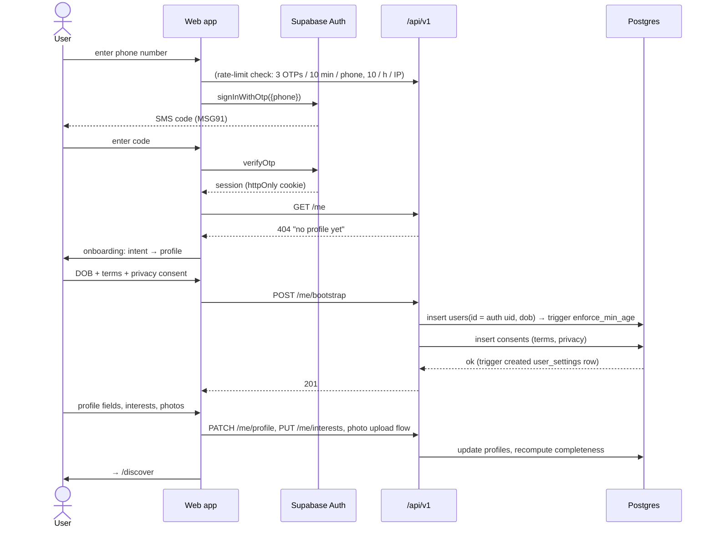
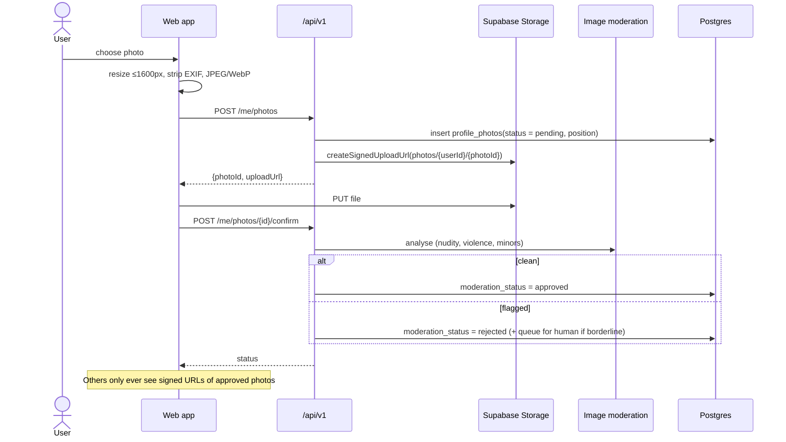
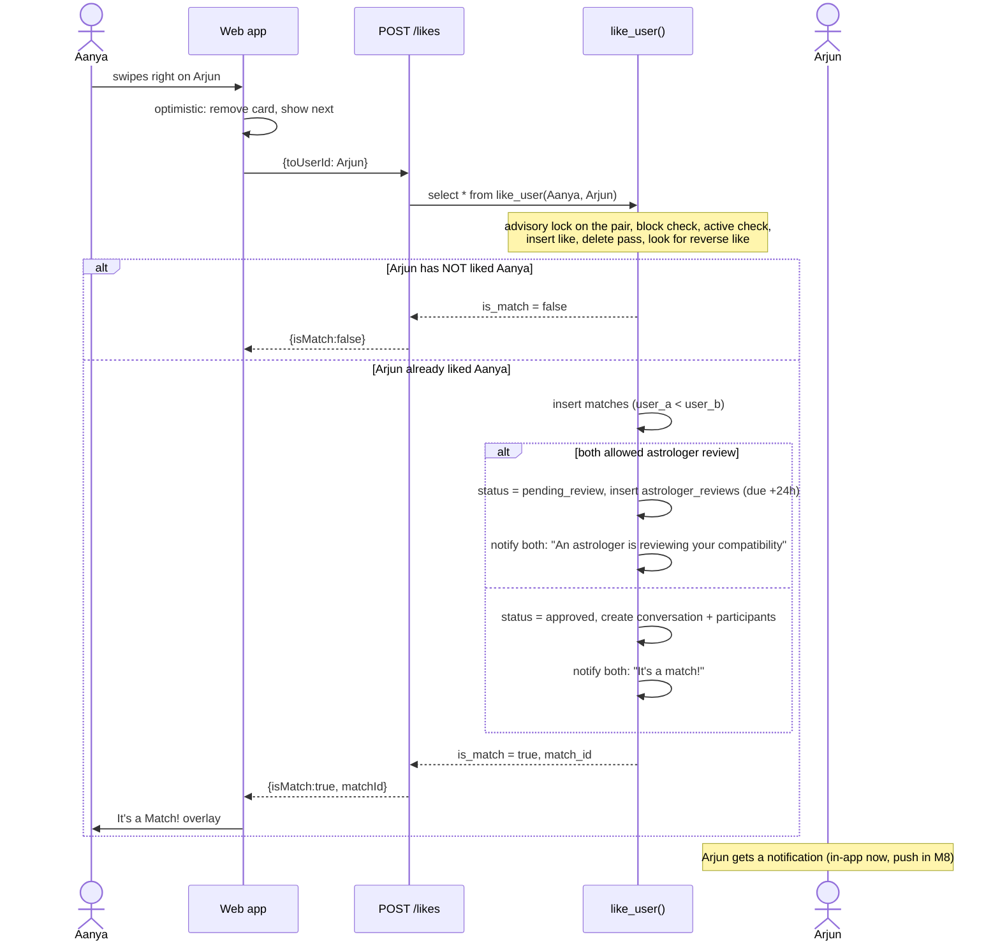
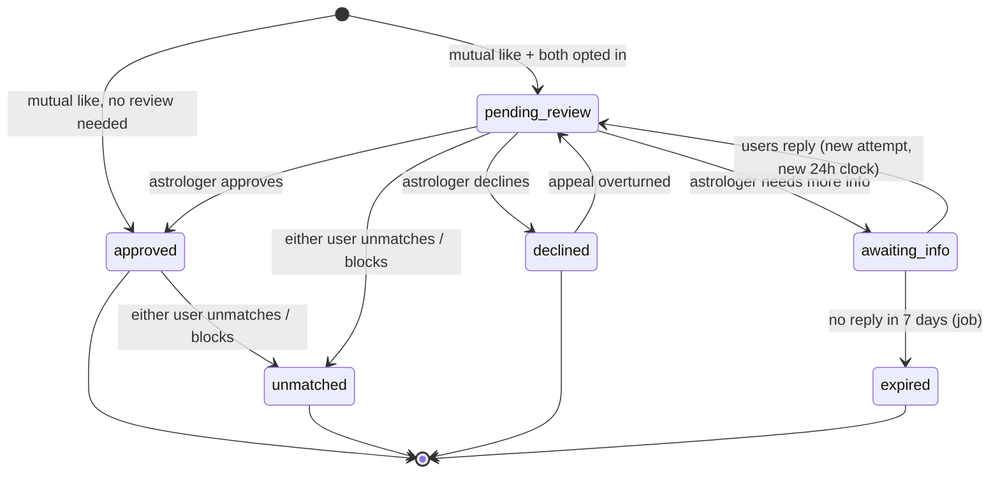
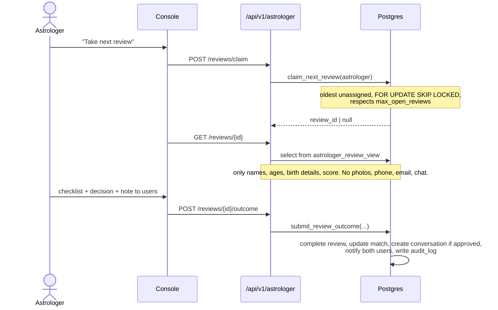
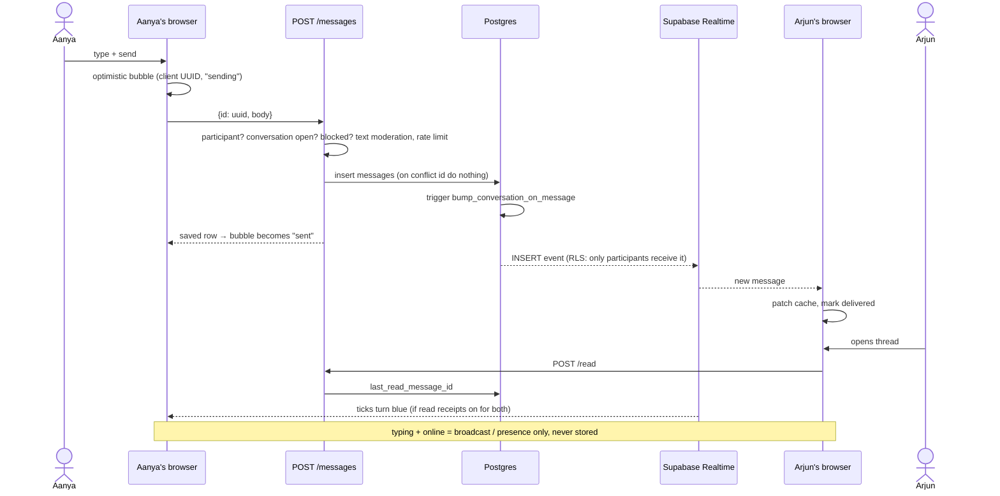
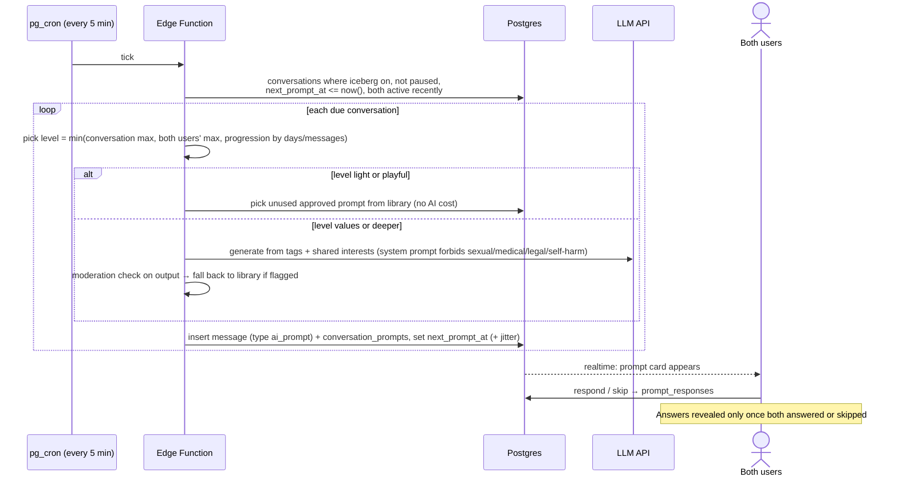
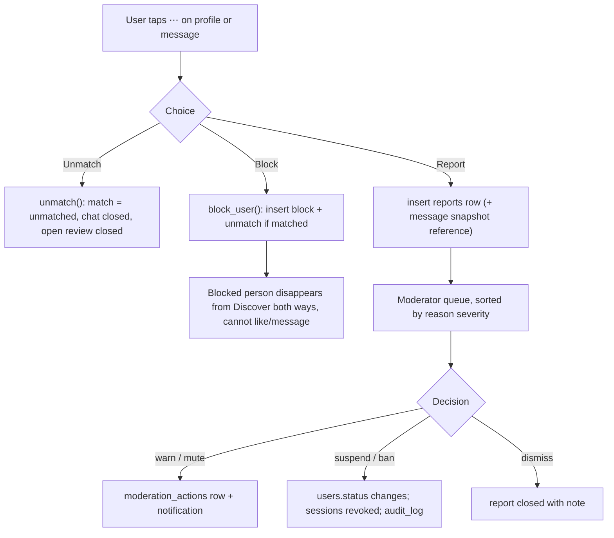
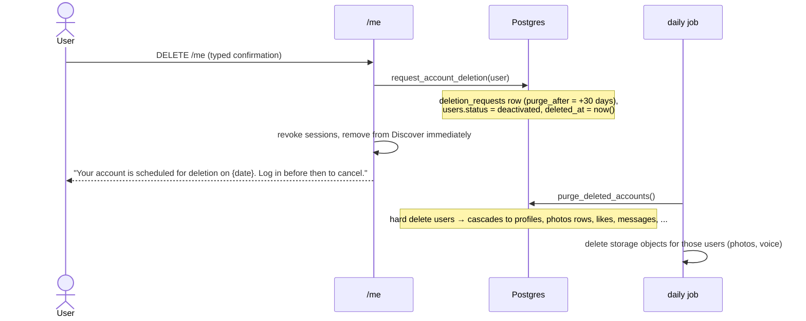

# 07 – User flows

Sequence diagrams for every flow that crosses more than one component. They render on GitHub and in
VS Code (Markdown Preview Mermaid Support extension). When code and diagram disagree, fix whichever is wrong in the same PR.

## 1. Sign-up and first-time setup (M1–M2)



Failure cases to handle: wrong/expired OTP (attempt limit), under-18 DOB (400 `validation_failed`, friendly message, nothing stored), duplicate phone (merge into the existing account), SMS provider outage (fallback to email magic link).

## 2. Photo upload with moderation (M2)



## 3. Discover → like → match (M3)



Why the lock matters: if Aanya and Arjun like each other in the same millisecond, without the per-pair advisory lock *both* transactions could see "no reverse like yet" and the match would never be created.

## 4. Astrologer review lifecycle (M4)





## 5. Chat with live updates (M5)



## 6. Iceberg prompt cycle (M6)



Cost guards: daily budget per environment, max 1 LLM call per conversation per day, circuit breaker → library fallback.

## 7. Event registration, waitlist and QR check-in (M7)

```mermaid
sequenceDiagram
  actor U as User
  participant API as /events
  participant DB as Postgres
  actor S as Staff
  participant Scan as Check-in screen

  U->>API: POST /events/{id}/register
  API->>DB: lock event row; count registered
  alt capacity free
    DB-->>API: status = registered, qr_token
  else full
    DB-->>API: status = waitlisted, waitlist_position
  end
  API-->>U: ticket (QR of signed token)
  Note over U: cancel → job promotes waitlist #1 and notifies
  S->>Scan: scan QR at the door
  Scan->>API: POST /events/check-in {token}
  API->>DB: update ... set status = checked_in where qr_token = $1 and status = registered (single use)
  API-->>Scan: ✅ name / ❌ already used / ❌ wrong event
```

## 8. Safety: block, report, unmatch (M8)



Hard rules: reports about `underage` or `threat` are escalated immediately and the reported account is auto-suspended pending review.

## 9. Account deletion and data export (M8)



Open item for M8: storage objects are not removed by the SQL cascade, so the purge job must also delete `photos/{userId}/*`, `voice-intros/{userId}/*`, `chat-media/*` for the purged ids.
