# 10 – Roadmap and tasks

Each milestone is a **vertical slice**: database → API → UI → tests → deployed to staging.
A milestone is done only when its *Definition of Done* is ticked. Tick boxes here as we go.

Estimates assume one developer working steadily with Claude Code; treat them as ordering, not promises.

```mermaid
gantt
  dateFormat  X
  axisFormat  %s
  title Milestones (relative order)
  M0 Foundation           :done, m0, 0, 1
  M1 Auth and accounts    :m1, 1, 2
  M2 Profile and onboarding :m2, 2, 3
  M3 Discover and matching :m3, 3, 4
  M4 Astrology and review :m4, 4, 6
  M5 Chat                 :m5, 6, 7
  M6 Iceberg AI and games :m6, 7, 9
  M7 Events               :m7, 9, 10
  M8 Safety, PWA, launch  :m8, 10, 12
```

---

## M0 – Foundation ✅ (code complete; deployment accounts still to connect, see last item)

- [x] Repo layout (`db/`, `web/`, `docs/`, `.github/`), root convenience scripts
- [x] Next.js 16 + TypeScript + Tailwind + shadcn/ui, brand tokens, landing page (screen 1)
- [x] Validated env config (`env.server.ts`, `env.public.ts`) + fail-fast `instrumentation.ts`
- [x] `pg` pool tuned for serverless + pooler; `query` / `withTransaction`
- [x] `apiRoute()` wrapper: request id, auth guard (closed by default), Zod body/query, error mapping, logging
- [x] First full slice: `GET /api/v1/interests` and `/colleges` (repository → service → route), health + readiness endpoints
- [x] Vitest unit tests (env, errors, route wrapper) + DB integration test (runs when `TEST_DATABASE_URL` set)
- [x] Docker Compose for local Postgres + PostGIS (port 5433)
- [x] GitHub Actions: CI (db + web jobs) and migrate-per-environment workflow
- [x] Security headers; `vercel.json` Mumbai region
- [x] This documentation set
- [ ] **You do (needs your accounts):** push to GitHub, create branch `staging`, connect Vercel, create two Supabase projects, add GitHub Environments + secrets (doc 04). *Verify:* `https://staging.<domain>/api/ready` returns `{"status":"ready"}`.

## M1 – Auth and accounts

*You will learn:* cookie sessions with Supabase SSR, Next.js proxy, RLS, rate limiting.

- [ ] Add `supabase/` with CLI config; local stack via `npx supabase start` (Auth, Storage, Realtime, Inbucket mail); test OTP for local phone login
- [ ] Migration `011_rls.sql`: enable RLS everywhere, helper functions, policies, **tests**; drop unused `auth_otps`, `user_sessions`
- [ ] `@supabase/ssr` clients (browser / server), `proxy.ts` session refresh, `getSessionUser()` real implementation (load role/status, reject banned)
- [ ] Pages: `/sign-up`, `/sign-in`, `/verify` (phone OTP; Google; college-email magic link later)
- [ ] `POST /me/bootstrap` (DOB 18+, consents), `GET /me`
- [ ] Upstash rate limiter integration + per-route `rateLimit` option in `apiRoute`
- [ ] Sentry (server + client) + PostHog init; request id attached to Sentry events
- [ ] CSP with nonces; CSRF origin check on mutating routes
- [ ] Dependabot + `npm audit` in CI
- [ ] Playwright set up; first test: sign up with test OTP
- **DoD:** a new user can sign up with a test OTP locally and on staging, lands in onboarding; unauthenticated call to a `user` route returns 401; RLS tests prove isolation; Sentry receives a test error from staging.

## M2 – Profile and onboarding (screens 2, 3, 13)

- [ ] Zod schemas (`intent`, `profile`, `preferences`); React Hook Form wiring
- [ ] Onboarding pages with progress bar; guards (`(app)` layout redirects)
- [ ] `PATCH /me/profile`, `PUT /me/interests`, `PUT /me/location` (rounded), `GET/PATCH /me/settings`; completeness calculation in service
- [ ] Photo pipeline: client resize, signed upload, confirm, moderation hook (fake first, Sightengine/Rekognition second), reorder via deferrable unique constraint
- [ ] Settings page with tabs and consent toggles writing `consents`
- [ ] App shell: bottom tabs (mobile) / sidebar (desktop)
- [ ] `images.remotePatterns` for Storage host
- **DoD:** a new user completes onboarding in < 3 minutes on a phone; profile completeness reaches 100 %; photo shows only after approval; settings persist; Playwright covers the path.

## M3 – Discover and matching (screens 4, 7)

- [ ] `GET /discover` (filters All / Compatible / Near you; cursor pagination) using `discover_profiles()`
- [ ] SwipeCard with Framer Motion + buttons + keyboard; Zustand store for deck/undo; prefetch next cards
- [ ] `POST /likes`, `/passes`, `/saved`; Match modal; `GET /matches`, `/matches/:id`, unmatch
- [ ] Compatibility v0 service + `compatibility_scores` cache job
- [ ] In-app notifications list + unread badge (Realtime)
- [ ] Load test `discover_profiles` with 100 k generated profiles; tune indexes
- **DoD:** two seeded users can like each other and both see the match instantly; concurrent-like test passes; blocked/unmatched people never reappear; p95 `/discover` < 300 ms on staging data.

## M4 – Astrology and astrologer review (screens 5, 6, 11)

- [ ] `PUT /me/astrology` + consent + `/onboarding/astrology`
- [ ] Compatibility detail page, tabs, report; "Request review" / auto-review settings logic
- [ ] Review timeline UI (screen 6), needs-info reply form, appeal flow
- [ ] Astrologer console: queue, claim, packet view (from `astrologer_review_view`), checklist, outcome
- [ ] Jobs: due-soon reminders, escalate overdue, expire stale `awaiting_info`
- [ ] Audit log entries verified for each outcome
- **DoD:** end-to-end on staging: like → pending review → astrologer approves → both notified → chat unlocks; astrologer cannot see photos/phone/email (test); two astrologers cannot claim the same review (test).

## M5 – Chat (screen 8)

- [ ] `GET/POST` messages, read pointer, conversation list with unread counts
- [ ] Realtime subscription patching TanStack cache; typing + presence (broadcast/presence)
- [ ] Optimistic send with client UUID, retry, idempotency
- [ ] Text moderation on send; rate limit; report/block from the thread
- [ ] Voice notes + images via signed upload (private bucket), duration limits
- [ ] Desktop split view
- **DoD:** two browsers chat live with < 1 s latency; reconnect after offline recovers missed messages; non-participants cannot read or subscribe (RLS tests); Playwright two-context chat test.

## M6 – Iceberg AI and games (screens 9, 10)

- [ ] Prompt scheduler (pg_cron + Edge Function), progression rules, per-conversation controls
- [ ] LLM integration behind interface; budget guard; moderation of output; fallback to library
- [ ] PromptCard UI, answer/skip, countdown, reveal-after-both
- [ ] Game framework + This or That + Would You Rather; then Two Truths & a Lie, Guess Each Other, Emoji Story
- [ ] Admin tooling to review/retire prompts (basic)
- **DoD:** staging conversation receives a prompt on schedule; skipping is frictionless; LLM outage degrades to library silently; one full game completes between two users.

## M7 – Campus events (screen 12)

- [ ] Event list/detail pages (public SEO-friendly detail via static + ISR-style cache), register/cancel/waitlist
- [ ] Ticket with QR, check-in scanner, admin event management, college scoping
- [ ] Reminders (24 h, 2 h); post-event matching opt-in
- **DoD:** capacity race test passes; waitlist promotes in order; QR cannot be reused; admin can create/publish an event.

## M8 – Safety, notifications, PWA, launch hardening

- [ ] Block/report UI, moderator queue and actions, auto-suspend rules
- [ ] Web push (VAPID) + Serwist service worker + install prompt; email via Resend
- [ ] Data export + account deletion UI; storage purge in the daily job
- [ ] Admin console basics (astrologers, audit log search)
- [ ] Cloudflare (DNS, WAF, Turnstile), uptime monitor, Sentry alerts, backups verified by a **restore drill**
- [ ] k6 load test, accessibility audit, legal pages (Terms, Privacy, Guidelines), DLT-approved SMS templates
- [ ] Production Supabase with PITR, secrets rotated, release checklist rehearsed on staging
- **DoD:** soft launch with a small campus group on production; zero P1 bugs for a week; on-call runbook written.

---

## Decisions still open (owner: you)

| # | Decision | Needed by |
|---|----------|-----------|
| 1 | Domain name and who owns the Cloudflare/Vercel/Supabase/GitHub org accounts | M0 deploy |
| 2 | Astrologer review: free / limited / paid | M4 |
| 3 | LLM vendor and monthly budget | M6 |
| 4 | SMS provider (MSG91 vs Twilio) and DLT registration status | M1 (start immediately) |
| 5 | College-email verification at sign-up or only for events | M2 |
| 6 | Support/grievance contact and legal entity for the privacy policy | M8 |

## Working agreement per task

1. Pick the next unticked item in the current milestone.
2. Branch from `staging`; small PRs (< 400 changed lines where possible).
3. Write/adjust the doc section **first** if behaviour changes; then code + tests.
4. `npm run check` green → PR into `staging` → preview URL review → merge → verify on staging → tick the box here.
